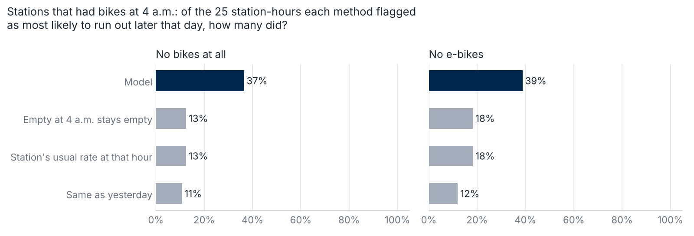
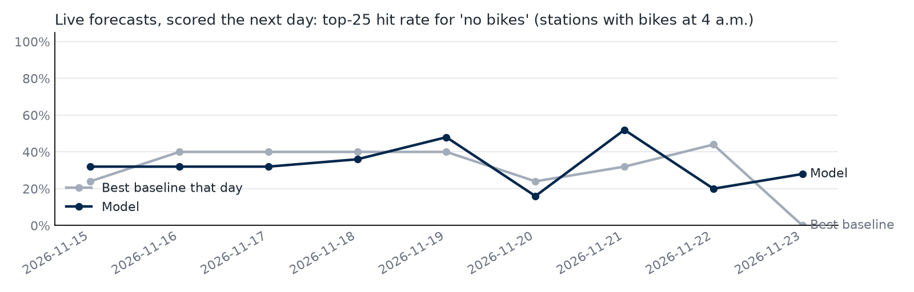

# Indego: which stations will run out of bikes today?

Every morning at 4 a.m., this repo forecasts, for each of Philadelphia's ~320 Indego bike share stations, the chance it has **no bikes** and the chance it has **no e-bikes** in each hour from 5 a.m. to midnight. The next morning it checks yesterday's forecast against what actually happened and adds the result to a running track record.

It builds on two earlier projects. In [indego-bike-share-analysis](https://github.com/emilyou561-beep/indego-bike-share-analysis) I found that almost all of 2026's growth was e-bikes. Trip files can't show the rides lost when a station is empty, so I started [indego-station-status-archive](https://github.com/emilyou561-beep/indego-station-status-archive) to record every station's bike count every 15 minutes. This repo turns that archive into a forecast.

**Backtest result:** the useful case is a station that still has bikes at 4 a.m. and runs out later in the day. Among those, the 25 station-hours the model flagged as most likely to run out each day actually ran out **37%** of the time for bikes and **39%** for e-bikes. The best simple rule managed 13% and 18%, so the model is roughly 2 to 3 times better at pointing a rebalancing crew to the right place. Empty hours are rare to begin with (7% and 11%).



<!-- daily:start -->

### Today's forecast (Tue Nov 24, 2026)

Stations that had e-bikes at 4 a.m. but are most likely to **run out of e-bikes** during the morning rush (7–10 a.m.):

| Station | Chance of no e-bike | Hours above 50% |
|---|---:|---|
| 17th & Pine | 41% | – |
| 17th & Locust | 37% | – |
| Barnes Foundation | 32% | – |
| 15th & Spruce | 31% | – |
| 44th & Walnut | 31% | – |
| 12th & Callowhill | 29% | – |
| 6th & Master | 29% | – |
| 48th & Spruce | 28% | – |

Full forecast: [`forecasts/2026-11-24.csv`](forecasts/2026-11-24.csv)

### Live track record (9 days scored so far)



| Last 7 days | Top-25 hit rate | Same, stations with bikes at 4 a.m. | AUC |
|---|---:|---:|---:|
| No bikes | 94% | 33% | 0.86 |
| No e-bikes | 99% | 34% | 0.85 |

<!-- daily:end -->

## How it works

**Target.** A station-hour counts as "empty" if any snapshot in that hour showed 0 bikes (or 0 e-bikes for the second target). Stations that weren't renting are left out. About 7% of station-hours are empty and 11% have no e-bike.

**Timing.** The forecast for day D is made with data up to 4:00 a.m. on D, covering 5:00 a.m. to 11 p.m. Every feature is built only from what was known at 4 a.m. [`tests/test_features.py`](tests/test_features.py) checks this by deleting all data after 4 a.m., rebuilding the features, and confirming nothing changes.

**Features** ([`forecast/features.py`](forecast/features.py))

| Group | Examples |
|---|---|
| Right now (4 a.m.) | bikes, e-bikes and open docks; how full the station is |
| Station history | how often this station is empty overall, at this hour, on weekdays vs. weekends, and in the last 7 days. Smoothed toward the system average when history is thin |
| Yesterday | was it empty at the same hour yesterday |
| Trip demand | average starts per hour from 12 months of trip data, from the earlier analysis repo |
| Calendar | hour, weekend, hours ahead of the forecast |

**Model.** Gradient-boosted trees (`HistGradientBoostingClassifier`), one per target, retrained every morning on all complete days so far. It's compared against three simple rules:

| Rule | Idea |
|---|---|
| Empty at 4 a.m. stays empty | whatever the station looks like now, it stays that way |
| Station's usual rate at that hour | the station's own history for that hour |
| Same as yesterday | whatever happened at that hour yesterday |

## Backtest

Rolling backtest from Nov 8 to Nov 14, 2026: for each day, train only on the days before it, then score that day. That's about 5,500 station-hours per day.

| Target | Method | AUC | Avg. precision | Brier | Top-25 hit rate | Top-25, stations with bikes at 4 a.m. |
|---|---|---:|---:|---:|---:|---:|
| No bikes | **Model** | **0.87** | **0.44** | **0.050** | **85%** | **37%** |
| | Empty at 4 a.m. stays empty | 0.78 | 0.29 | 0.075 | 45% | 13% |
| | Station's usual rate | 0.73 | 0.19 | 0.060 | 34% | 13% |
| | Same as yesterday | 0.63 | 0.15 | 0.095 | 13% | 11% |
| No e-bikes | **Model** | **0.85** | **0.51** | **0.072** | **87%** | **39%** |
| | Empty at 4 a.m. stays empty | 0.78 | 0.38 | 0.106 | 55% | 18% |
| | Station's usual rate | 0.71 | 0.24 | 0.091 | 41% | 18% |
| | Same as yesterday | 0.64 | 0.20 | 0.140 | 14% | 12% |

Average precision is the more useful number here than AUC because empty hours are rare (7% and 11%). The top-25 hit rate is the one an operations team would actually feel: if they could send a rebalancing van to 25 places, how often would it be the right place?

**Why two hit rates.** The plain top-25 number looks great (85%), but when I checked the picks, a lot of them were a couple of stations that sat empty all day, often from 4 a.m. on. Getting those right is easy and not very useful. The last column only counts stations that still had bikes at 4 a.m., so the model has to predict that a station will *drain* during the day. That's the number I track in the live record below. (For those stations the "stays empty" rule has nothing to go on, so it falls back to the station's usual rate and the two tie.)

**What drives it.** On permutation importance ([`results/feature_importance.csv`](results/feature_importance.csv)), the strongest signals are how many bikes the station has at 4 a.m. and how full it is, followed by the station's own history. Hour of day matters less than I expected, which fits November: low ridership means stations drain slowly and the overnight state carries further into the day.

## Daily run

[`.github/workflows/daily.yml`](.github/workflows/daily.yml) runs at about 4:15 a.m. Philadelphia time:

1. pulls the latest snapshots from the archive repo
2. scores every past forecast whose day is now over ([`results/daily_scores.csv`](results/daily_scores.csv))
3. retrains on all complete days and writes today's forecast to [`forecasts/`](forecasts/)
4. updates the chart and the "Today's forecast" section above

## Run it yourself

```bash
git clone https://github.com/emilyou561-beep/indego-station-status-archive ../indego-station-status-archive
pip install -r requirements.txt

python -m forecast.backtest --archive ../indego-station-status-archive   # rebuild the backtest
python -m forecast.daily --archive ../indego-station-status-archive      # today's forecast
python -m pytest -q
```

```text
forecast/data.py        load snapshots, roll them up to station-hours
forecast/features.py    features as of 4 a.m. (no look-ahead)
forecast/model.py       model, baselines, scoring
forecast/backtest.py    rolling backtest + feature importance
forecast/daily.py       the daily job
forecast/report.py      charts and the README section
data/station_hour_profile.csv   starts per station-hour from 12 months of trips
```

## Limits and what's next

- **Short history.** The archive started Nov 4, 2026, so the backtest is one week, all in late fall. The track record above is the real test, and it gets longer every day.
- **No weather yet.** Rain and cold change ridership a lot. Adding the day's forecast from a weather API is the next feature.
- **Hourly, not exact.** An hour counts as empty even if the station was empty for only one 15-minute snapshot.
- **Next question:** combine the forecast with typical demand per station-hour to estimate how many rides are lost each day, and which stations would gain the most from more e-bikes.
